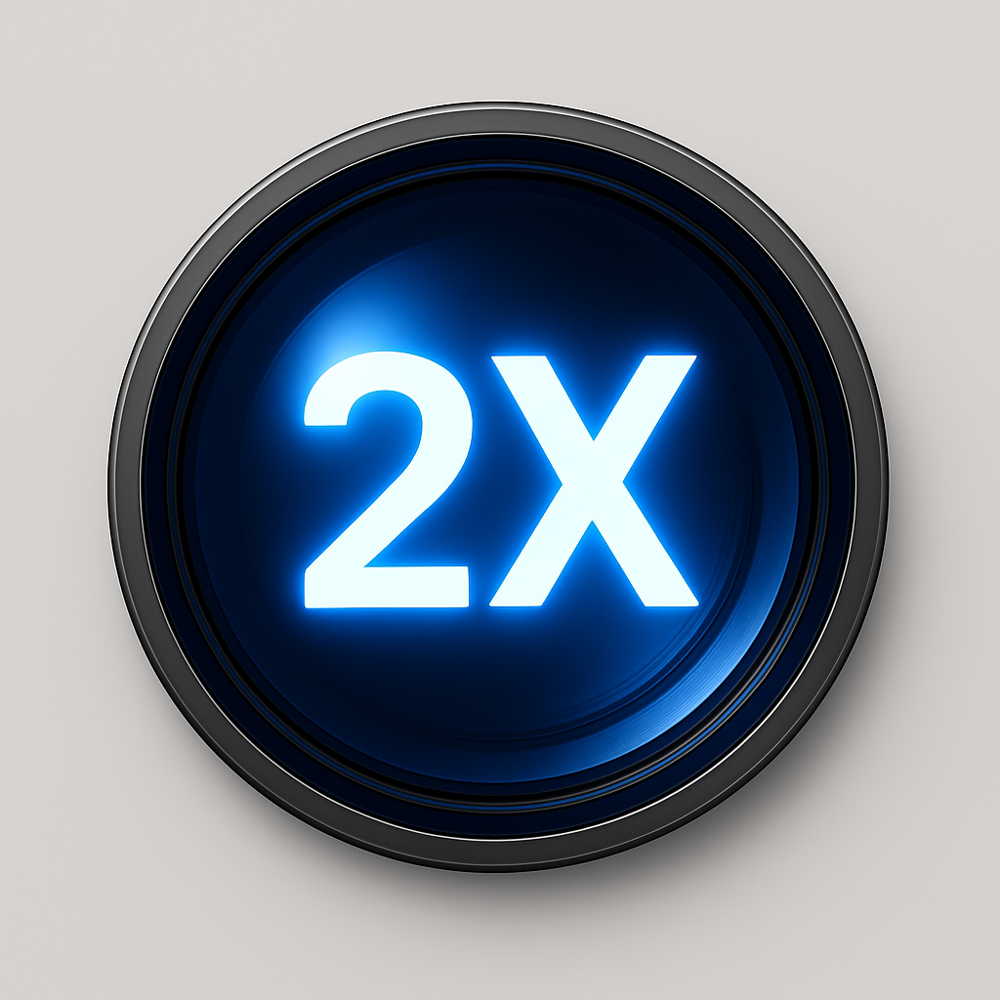
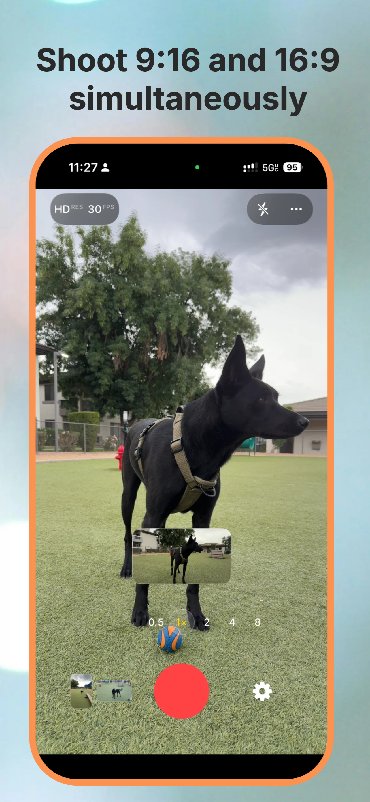
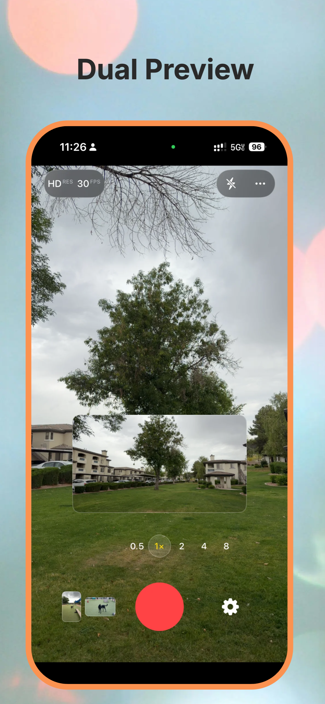
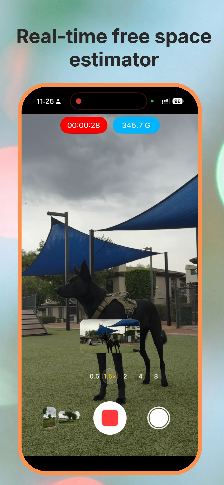
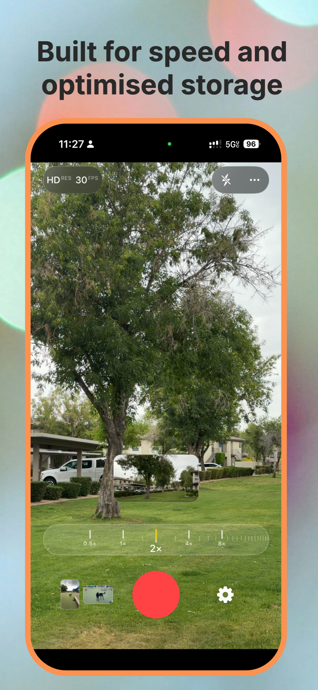

# Portscape Camera Support

  

Official support repository for **Portscape Camera**.

## Privacy Policy

[Privacy Policy](PRIVACY_POLICY.md) (App Store Connect URL after push: `https://raw.githubusercontent.com/hemenduroy/portscape-support/main/PRIVACY_POLICY.md`)

Portscape Camera helps you record once and automatically save both:
- portrait video (9:16)
- landscape video (16:9)

## Get Help

If you need help, please open a GitHub issue:

👉 https://github.com/hemenduroy/portscape-support/issues

When reporting a problem, include:
- iPhone model and iOS version
- app version/build
- exact steps to reproduce
- what you expected vs what happened
- screen recording or screenshots, if possible

## Feature Requests

Have an idea? Open an issue and tag it as a feature request.

## Media

  
  
  
  

